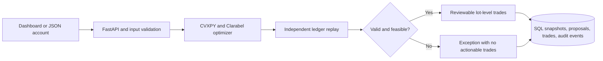

# LotWise

**One investment model. Individual account constraints. Auditable trade proposals.**

LotWise is a Python portfolio implementation lab for simulated separately managed
accounts (SMAs). It converts model weights into account-specific trade proposals
while considering individual tax lots, investment exclusions, cash reserves,
transaction costs, position caps, and a net realized-gain budget.

The project focuses on the engineering between an investment decision and a
reviewable trade list: validated inputs, constrained optimization, independent
ledger replay, SQL persistence, idempotent API requests, and actionable exceptions.

## Try it locally

Python 3.13 is the tested environment. From this directory:

```bash
python3 -m venv .venv
source .venv/bin/activate
pip install -r requirements.lock
pip install --no-deps -e .
uvicorn lotwise.api:app --host 127.0.0.1 --port 8000
```

Open **http://127.0.0.1:8000** for the review dashboard, or **/docs** for the API.
The default database is local SQLite; no market-data subscription is required.

The dashboard offers three fictional scenarios: an unrestricted account, an
account with two excluded stocks, and an account whose required stock exit
conflicts with its gain budget. Adjust the rules and inspect the resulting trades
and persisted audit event. Infeasible accounts receive an explanation and no trades.

For a standalone JSON proposal:

```bash
lotwise --output proposal.json
lotwise --input benchmarks/results/example_account.json --output proposal.json
```

### PostgreSQL with Docker Compose

```bash
docker compose up --build
```

Compose starts PostgreSQL 17 and the API, waits for database readiness, and exposes
the dashboard on localhost:8000. The credentials in Compose are local demo values.
The PostgreSQL integration test is included in CI. Local measurements in this
repository used SQLite; Docker and PostgreSQL were not available for local verification.

## Measured results

Reference run: **1,000 synthetic accounts, 20 securities and 60 tax lots per
account, seed 42, three sequential runs** on macOS arm64 / Python 3.13.3.
Full environment details and unrounded values are in
[`benchmarks/results/summary.json`](benchmarks/results/summary.json).

| Measurement | Result | Interpretation |
| --- | ---: | --- |
| Median batch runtime | 2.07 seconds | 1,000 solves, replay checks, and FIFO comparisons; excludes database I/O |
| Tax lots considered per batch | 60,000 | 60 independently modeled purchase lots per account |
| Mean allocation RMSE reduction | 54.8% | 206.98 to 93.62 basis points vs the starting portfolio |
| Positive realized gains vs FIFO | 78.0% lower | Identical security-level sell quantities; different lot selection |
| Independent constraint violations | 0 across 3,000 proposals | Within the documented numerical tolerance |
| Deliberately infeasible scenarios | 50 / 50 detected | Same economic conflict with distinct account IDs; not 50 types of conflict |
| Proposals persisted and retrieved | 1,000 in 4.34 seconds | Separate on-disk SQLite measurement |

The FIFO comparison isolates tax-lot selection, not whole-strategy performance.
It measures **positive realized gains**, not tax savings, after-tax returns, or
investment performance. Synthetic lots are ordered oldest-to-newest with cost
basis at 65%, 90%, and 115% of the fixed price. The counterfactual FIFO trades
may exceed the account's gain budget. The result depends on these fixture choices.
Prices are synthetic snapshots, not historical market data.

Reproduce the run:

```bash
python benchmarks/run.py --accounts 1000 --seed 42 --runs 3
```

This writes a summary, per-account CSV, example input/output, and an ignored local
audit database. Each repetition uses a fresh optimizer; first-solve compilation
overhead is included. Runtime varies by machine. The 54.8% value is a reduction
in the mean cross-sectional weight RMSE, not return tracking error. Exclusions
can increase an individual account's distance from the original model.

## Architecture



- **Optimization:** A convex quadratic objective balances target-weight error,
  turnover, and positive realized lot gains. Account constraints are hard limits.
  A parameterized problem is cached by security/lot count for repeated solves.
- **Replay:** A separate module recalculates holdings, cash, transaction costs,
  gains, restrictions, caps, and lot availability from the actual trade list.
  A solver's success flag alone is insufficient to release a proposal.
- **Persistence:** SQLAlchemy stores input snapshots and normalized securities,
  tax lots, trades, proposals, and audit events in one transaction. Each proposal
  includes a SHA-256 input fingerprint and solver status.
- **Reliability:** A unique idempotency key returns the original proposal for an
  identical retry and HTTP 409 for changed inputs. A process-local lock protects
  shared solver parameters; database uniqueness protects duplicate persistence.
- **Review UI:** A dependency-free dashboard displays trade-level gains, changes
  in model distance, and the persisted audit event.

### API

| Method | Route | Purpose |
| --- | --- | --- |
| GET | `/` | Local review dashboard |
| GET | `/health` | Simulation service status |
| GET | `/demo/account?scenario=restricted` | Fictional example; also `balanced` or `infeasible` |
| POST | `/proposals` | Validate, solve, replay, and persist an account proposal |
| GET | `/proposals/{id}` | Retrieve the original proposal |
| GET | `/proposals/{id}/audit` | Inspect its persisted audit event |

```bash
curl -s 'http://127.0.0.1:8000/demo/account' > /tmp/account.json
curl -s -X POST http://127.0.0.1:8000/proposals \
  -H 'Content-Type: application/json' \
  -H 'Idempotency-Key: demo-001' \
  --data-binary @/tmp/account.json
```

## Verification

```bash
pytest -q
ruff check src tests benchmarks
ruff format --check src tests benchmarks
```

Tests cover lot selection, gain budgets, cash-only accounts, exclusions, position
caps, zero fees, malformed/non-finite inputs, oversells, tampered gains,
infeasibility, deterministic solves, API retrieval, concurrent duplicate requests,
idempotency conflicts, and transaction rollback. Seeded tests replay proposals
across three additional fixture configurations. CI also provisions PostgreSQL and
executes the database integration test. See [the test report](docs/validation.md).

## Modeling boundaries

- Fractional shares, one price snapshot, and proportional transaction costs.
  Position and cash constraints use **initial** account NAV. Trade quantities are
  not rounded to executable whole shares after optimization.
- The target model sums to 100%; fees and required cash prevent a perfect match.
  Exclusions mean full liquidation of that security, not a prohibition on new buys alone.
- Trade direction is fixed before optimization: sell securities above the lesser
  of their target and cap, buy other eligible securities. This prevents same-name
  buy/sell round trips but can exclude otherwise feasible strategies. An infeasible
  result applies to this restricted formulation, not every possible trading plan.
- Net realized gains are constrained; positive realized gains receive a separate
  objective penalty. Losses may offset gains mathematically. Tax rates, holding
  periods, wash-sale windows, cross-account activity, and loss carryforwards are
  not modeled. This is not a complete tax-loss harvesting system.
- Replay tolerance is `max($0.00001, initial_NAV × 1e-7)`. Solver-inaccurate results
  are accepted only if independent replay passes; raw solver status is retained.
- Audit records are immutable through the API, not cryptographically tamper-proof.
  This localhost demo has no authentication, live brokerage connection, or execution
  capability. It is not intended for public deployment with real client data.

## Design references

- [CVXPY parameterized problems and warm starts](https://www.cvxpy.org/tutorial/solvers/index.html)
- [SQLAlchemy transaction management](https://docs.sqlalchemy.org/en/20/orm/session_transaction.html)

MIT licensed. Independent educational project; no affiliation with an investment manager.

